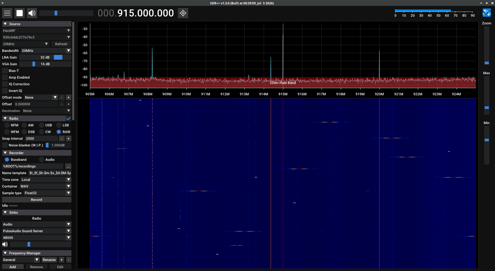

# GTLUG Model Rocketry Project
## Introduction

At [GTLUG's][gtlug-url] July 2024 monthly meeting, we started work on a model rocketry group project.

We've set out to solve a simple problem: How do we launch a model rocket without losing it?

We've since met several times to discuss various aspects of the project.

As a GTLUG project, it covers a wide variety of common intersecting subjects that we regularly discuss in our meetings in general:

* Physics
* Radio Science
* Open Source Software
* Electronics
* 3D Printing
* Reverse Engineering
* AI

## Objective
The purpose of this project is to research, design, and build a telemetry package capable of launching on a model rocket.

## Plan
The current plan is to integrate discrete telemetry hardware into a 3D-printed nose-cone.

The chosen telemetry hardware hypothetically should be capable of high acceleration, and high altitude flights.

In this first iteration, we are targeting off-the-shelf entry-level [Estes®-style model rockets](https://estesrockets.com/), 
using standard solid chemical propellant engines with modest thrust.

We are also working on developing a [GNU Radio](https://www.gnuradio.org/) package for decoding telemetry data, and plotting the data in mapping software (i.e. Google Earth).

In future iterations, we will may target larger rocket platforms, adding LEDs, and auditory buzzers.

We **WILL NOT** pursue articulating flight control surfaces.  This is because such features would constitute missile construction, and is subject to regulation.

## Hardware
For this project, we've chosen the following hardware:
| Part                                      | Links                                                   | Description |
|-------------------------------------------|---------------------------------------------------------|-------------|
| Quest Egg Lofter Courier Model Rocket Kit | [Store][rocket-store-url] [Specs][rocket-specs-url] | A base model rocket kit designed to loft loads (an egg) in its nose-cone.  We have built two kits. |
| LILYGO® T-Beam SUPREME (u-blox, 915MHz)   | [Store][tbeam-store-url] [Firmware][softrf-url]     | A telemetry module capable of high acceleration and altitudes.   We have purchased two of these for redundancy. |
| LILYGO® 915MHz Omnidirectional Whip Antenna|                                                        | Included with T-Beam |
| Custom 3D-Printed Nose-Cone               |                                                         | Designed to house the telemetry module and mate with fuselage.
| RTL-SDR                                   | [Store][rtl-sdr-store-url] [Specs][rtl-sdr-specs-url] | A low-cost Software Defined Radio (SDR) USB dongle.  With a frequency range: 500kHz – 1766MHz and bandwidth of 2.4MHz. |
| HackRF                                    | [Store][hackrf-store-url]                               | An alternative SDR.  With a frequency range: 1MHz – 6GHz and bandwidth of 20MHz.  It's still TBD whether this or the RTL-SDR is adequate for telemetry decoding. |
| 900MHz 12dBi Yagi Antenna                | [Store][yagi-uda-store-url]                             | A high-gain Yagi-Uda directional antenna for receiving telemetry radio signals. |

### LILYGO® T-Beam SUPREME
This telemetry module has a very compact design.  It is the main component in [LILYGO®'s SoftRF Prime MkIII][softrf-url] project (see <a href="#softrf-firmware">SoftRF Firmware section</a>).

It features:
* A SX1262 LoRa transceiver with frequency range of 150MHz to 960MHz (global ISM bands)
* Multiple radio protocols supported
* U-blox M10 GPS/GNSS with high precision
* QMI8658 6-axis IMU capable of high acceleration
* An ESP32 with WiFi adapter and web UI for management
* MicroSD card slot for flight recordings (in [IGC][igc-url]), and post-flight analysis
* GPIO for future integration

### Custom 3D-Printed Nose-Cone
Using the Courier Model Rocket nose-cone for approximate geometry, while extending the length to fit the telemetry module.  

The design features 3 interconnecting parts:
1. **Telemetry module sled**: The T-Beam mounts to this. [[STEP](./CAD/inside%20sled.STEP)]
2. **Nose-cone top**: Has rails and clearance for 915MHz omnidirectinoal antenna for telemetry module to slide into. [[STEP](./CAD/Top%20Part.STEP)]
3. **Nose-cone base**: Mates with fuselage, connects to parachute/recovery phase, and has interlocking connectors to mate with nose-cone top.  Locks telemetry sled into nose-cone. [[STEP](./CAD/bottom%20Piece.STEP)]

Linked are the STEP model files used to 3D-print.

## Software
### SoftRF Firmware
The telemetry module, T-Beam SUPREME, comes stock with LILYGO®'s open source (GPLv3) [SoftRF firmware][softrf-url].  We have upgraded both T-Beams with the latest compatible release.  All management, including firmware upgrades are done via the built-in web server and simple web UI.

You can find the [SoftRF settings here](SOFTRF_SETTINGS.md).  We chose the Legacy (FLARM Air v7) protocol, because it appeared to be the best documented and included tho most telemetry/vector fields of all the available protocols.

### SDR++

We've been using [SDR++][sdrpp-url] (and either RTL-SDR or HackRF) to do radio spectrum analysis of telemetry transmission signals.

This tool is useful for visualizing the spectrum in a "waterfall plot" and identifying patterns in signals.  Once signals have been isolated, SDR++ can be used to capture base-band IQ recordings in a WAV file.  These captures have been used for later analysis.

### Telemetry Decoder (GNU Radio + KML/GeoJSON Feed)
We're targeting [GNU Radio][gnu-radio-url] as a means of telemetry decoding.  This is still in development.

The intended stack is:
* T-Beam Supreme/SoftRF
* Transmit on omni-directional 915MHz pigtail antenna
* Receive on Yagi-Uda directional antenna
* GNU Radio demodulates and decodes frames
* Node/TypeScript/Nest web service serves a KML and/or GeoJSON feed
* Google Earth (or some other mapping software) consumes feed and provides a GUI to user

The [SoftRF decoder package][softrf-decoder-url] is being developed (in a separate repository, see link) using open source Large Language Models (LLMs) like Qwen 3.8, hosted locally using Ollama, and using open source local-first autonomous agents like OpenClaw and Hermes.

<!-- MARKDOWN LINKS & IMAGES -->
<!-- https://www.markdownguide.org/basic-syntax/#reference-style-links -->
[gtlug-url]: https://gtlug.github.com/
[rocket-store-url]: https://bellevillehobby.com/product/quest-egg-lofter-courier-model-rocket-kit/
[rocket-specs-url]: https://www.apogeerockets.com/Rocket-Kits/Skill-Level-2-Model-Rocket-Kits/Courier#rocksim
[tbeam-store-url]: https://lilygo.cc/products/t-beam-supreme?variant=44907412193461
[softrf-url]: https://github.com/lyusupov/SoftRF/wiki/Prime-Edition-MkIII
[softrf-settings-url]: https://github.com/lyusupov/SoftRF/wiki/Settings
[igc-url]: https://en.wikipedia.org/wiki/IGC_(file_format)
[rtl-sdr-store-url]: https://www.sparkfun.com/rtl-sdr-blog-v3-usb-dongle-with-dipole-antenna-kit.html
[rtl-sdr-specs-url]: https://www.rtl-sdr.com/wp-content/uploads/2018/02/RTL-SDR-Blog-V3-Datasheet.pdf
[hackrf-store-url]: https://www.amazon.com/dp/B0BKH7Z2NJ
[yagi-uda-store-url]: https://www.data-alliance.net/900-mhz-12dbi-yagi-antenna-w-cable-to-n-female/
[sdrpp-url]: https://www.sdrpp.org/
[gnu-radio-url]: https://www.gnuradio.org/
[softrf-decoder-url]: https://github.com/NiX0n/softrf-decoder
