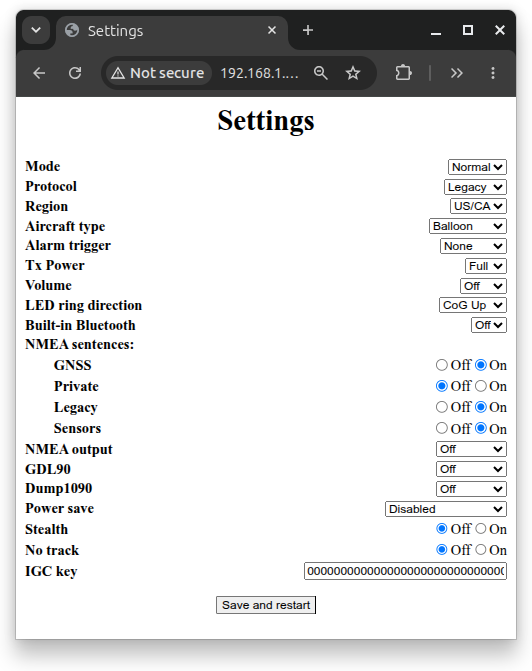
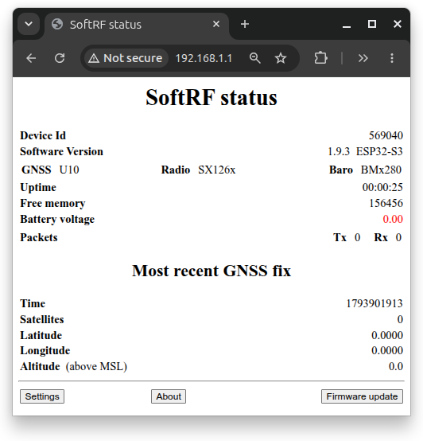

# SoftRF Settings
These are the settings currently set on the T-Beam Supreme telemetry modules:

| Configurable | Setting |
|--------------|---------|
| Mode         | Normal  |
| Protocol     | Legacy  |
| Region       | US/CA (915MHz) |
| Aircraft Type| Balloon |
| Alarm Trigger| None    |
| Tx Power     | Full    |
| Volume       | Off     |
| LED ring dir.| CoG Up  |
| NMEA: GNSS   | On      | 
| NMEA: Private| Off     | 
| NMEA: Legacy | On      | 
| NMEA: Sensors| On      | 
| NMEA output  | Off     |
| GDL90        | Off     |
| Dump1090     | Off     |
| Power save   | Disabled|
| Stealth      | Off     |
| No track     | Off     |

## Screenshots
<figure>
    <figcaption>Screenshot of SoftRF settings</figcaption>
    
</figure>

<figure>
    <figcaption>Screenshot of SoftRF status immediately after power-on.  No satellite locks yet.</figcaption>
    
</figure>
